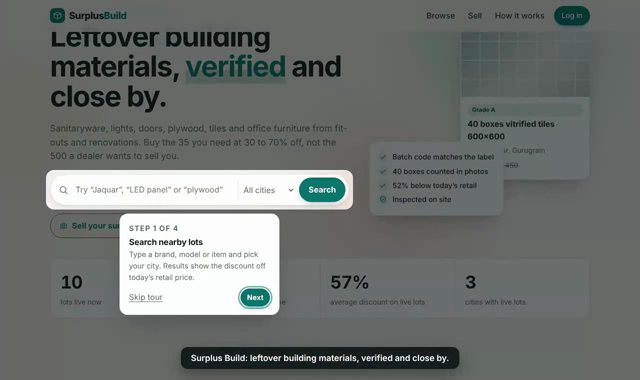

# Surplus Build v1.0

A marketplace for leftover building materials: sanitaryware, lights, doors, plywood, tiles, stone and office furniture from fit-outs and renovations. Sellers list surplus that stays on their own site; buyers nearby enquire, collect, inspect and pay the seller directly. Every lot is checked before anyone sees it.



## Run it on your Mac

You need Node 22.5 or newer (`node -v`).

```bash
cd ~/Downloads/surplus-build
npm install
npm run seed            # optional: 10 demo lots, demo seller, buyer and inspector
DEV_OTP=123456 ADMIN_PHONE=98XXXXXXXX npm start
```

Replace `98XXXXXXXX` with your own number. Open http://localhost:3000, log in with that number and the code `123456`. You are the admin.

**Upgrading from the first version?** Unzip over the old folder (answer `A` to replace all). Your `data` folder is not in the zip, so your lots and accounts stay; the database upgrades itself the first time you start the server. `npm run seed` skips itself if you already have lots, so delete the `data` folder first if you want the demo data.

Demo accounts created by `npm run seed` (all use your `DEV_OTP` code):

| Number | Who | Try |
| --- | --- | --- |
| 9000000010 | Demo Fit-out Co (seller) | My account → Selling: accept the waiting enquiry, record a sale, lower a price |
| 9000000011 | Demo Contractor (buyer) | My account → Buying: see pickup details, rate the seller; Alerts |
| 9000000012 | Kapoor Interiors (seller) | Lots in Noida and Delhi |
| 9000000013 | Ira (inspector) | Inspections: one open task on the tiles lot |

## A first-time user's path

1. **Home page.** A four-step tour points out search, selling, the guide and login. It shows once per browser; replay it from the footer ("Take the tour").
2. **How it works** (`/how-it-works`) explains selling, photos, buying, grades, checks, inspections, safe pickup, fees and the inspector role.
3. **Log in** with a mobile number and a 6-digit code. First login asks for a name, whether they buy or sell, and their city, then sends them to the right place.
4. **Sell** is a five-step wizard: the goods, quantity and price (with a live preview of the discount buyers will see), condition (grades explained), photos (previewed and shrunk on the phone), and pickup. A summary appears before submit.
5. **After submitting**, an animated confirmation explains what happens next. Clean lots go live at once; questionable ones go to review with the reason shown.
6. **My account** has four tabs: Overview (stats and a getting-started checklist), Selling (each lot's progress, enquiries to accept, record a sale, lower the price, withdraw), Buying (pickup details once accepted, rate the seller) and Alerts (saved searches).

A 98-second captioned walkthrough video of this path is delivered alongside this zip.

## Features

| Area | What it does |
| --- | --- |
| Accounts | Phone + OTP login, onboarding, settings, roles (member, inspector, admin) |
| Listings | Five-step wizard, mandatory label/count/items photos, client-side photo resizing, grades A–D, batch code required for tiles and stone, refused goods (cement, paint, putty, primer, adhesives) |
| Checks | Price at or above retail or under 10% of it, reused photos, Grade A stored outdoors or over 36 months; optional Claude photo check of label, batch code and count. Anything flagged goes to admin review |
| Buying | Search and filters, sort by newest/discount/price, enquiries with quantity, contact and address released only on acceptance, mobile sticky "Enquire" bar, photo lightbox, similar lots |
| Alerts | Save any filtered search; a message goes out the first time a matching lot goes live |
| Reservations | Accepting an enquiry holds those units for `RESERVE_DAYS` (default 3); other buyers see what is free, sellers cannot oversell, and expired holds release automatically |
| Sales | Partial sales, sell-out declines remaining enquiries, price drops, withdraw, a nudge after `PRICE_NUDGE_DAYS` unsold |
| Trust | Ratings after accepted enquiries, seller star rating and "as described" share shown on every lot, Verified badge with the inspector's count and photos |
| Inspections | Lots worth `INSPECT_THRESHOLD`+ get a task; admin assigns; inspector submits count, grade and at least one photo; mismatch pulls the lot back; per-inspection fee, payouts marked paid |
| Fees | Optional pilot listing fee with a UPI deep link (`UPI_ID`); admin confirms payment |
| Messaging | Every message is logged in Admin; sends through WhatsApp Cloud API and/or Twilio SMS when configured |
| Admin | Live lots, review queue, enquiry rate within 7 days, sell-through, days to sell, realized share of retail, repeat sellers, "not as described" rate, 14-day chart, people and roles, message log |
| Polish | Animations (respecting reduced-motion), light and dark themes, mobile navigation, installable (web app manifest), draft terms and privacy pages |

## Before you launch publicly

These need your accounts or your decisions, so they are switched off or left as drafts:

- **Logging in before SMS works.** Set `ADMIN_LOGIN_CODE` (12+ characters, secret) and log in with your `ADMIN_PHONE` and that code. Everyone else's login codes appear in Admin → Messages sent, so for a small pilot you can pass them on by WhatsApp yourself. Remove it once SMS works.
- **SMS and WhatsApp.** Set the Twilio or WhatsApp variables in `.env.example`. Indian SMS needs DLT registration of your sender ID and templates; WhatsApp needs approved templates for messages outside a 24-hour window. Until then, login codes only appear in Admin → Messages sent, so real users cannot log in.
- **AI photo check.** Set `ANTHROPIC_API_KEY`. It is covered by tests with a fake API, but has not been run against the live API: try it on 10 to 20 real listings and tune the prompt in `src/check.js`.
- **Terms and privacy** are drafts. Have a lawyer review them.
- **GST and payments.** The app never holds buyers' money. Ask a CA about your GST obligations as a platform before charging fees.
- **Hosting.** Remove `DEV_OTP`, set `COOKIE_SECURE=true` and `BASE_URL`, and keep the `data` folder on persistent storage with backups.

## Deploy

The repo includes a `Dockerfile` and a Render blueprint (`render.yaml`). On Render: push this folder to GitHub, choose New → Blueprint, pick the repo, and fill in `ADMIN_PHONE`, `BASE_URL` and any messaging keys. The blueprint mounts a 1 GB disk at `/app/data` for the database and photos; check Render's current plans, since persistent disks are not on the free tier. Any host that runs Docker with a persistent volume works the same way.

## Configuration

All settings are environment variables, listed with explanations in `.env.example`.

## Development

```bash
npm test     # 20 integration tests, including the upgrade from older data
npm run dev  # restarts on file changes
```

```
src/app.js           app setup, security headers, rate limit, sessions, shared helpers
src/routes/          public, auth (login, onboarding, settings), sell, account, staff (inspector, admin)
src/views/           pages; html.js auto-escapes everything interpolated
src/check.js         listing checks and the Claude photo check
src/notify.js        message outbox and SMS/WhatsApp delivery
src/db.js            schema and automatic migrations
public/js/app.js     progressive enhancement: wizard, previews, resizing, tour, lightbox, animations
public/style.css     the whole design system, light and dark
scripts/seed.js      demo data with drawn placeholder photos
tests/               integration tests and the v1 database fixture
```

Every page works without JavaScript; the script adds the wizard, previews, animations and tour on top.

### Known limits

SQLite on one server is right for a pilot; move to Postgres before running several servers. Photos are stored on local disk; move them to object storage (S3 or similar) at the same point. The rate limiter is in-memory, so keep a proxy-level limit in front in production.
